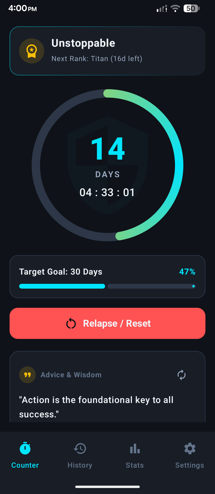
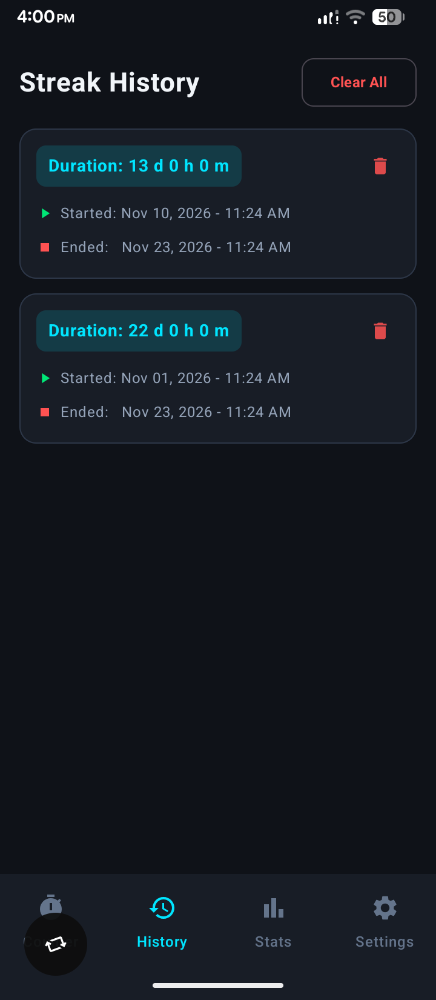
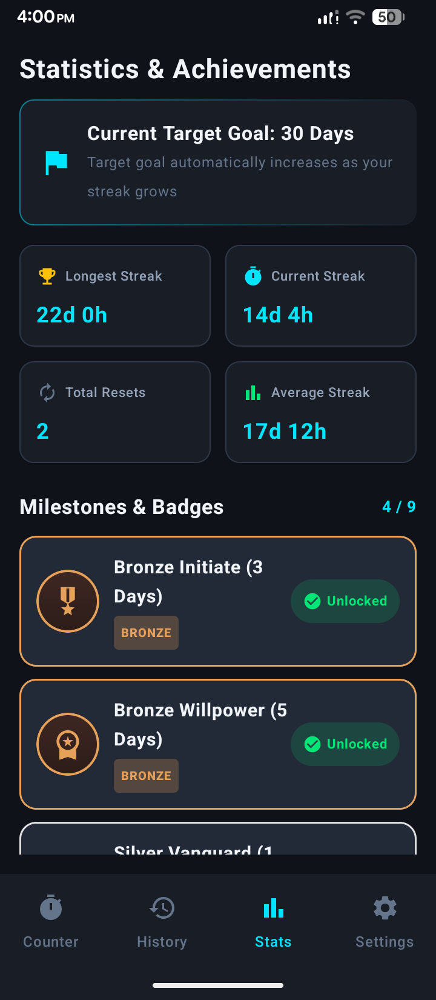
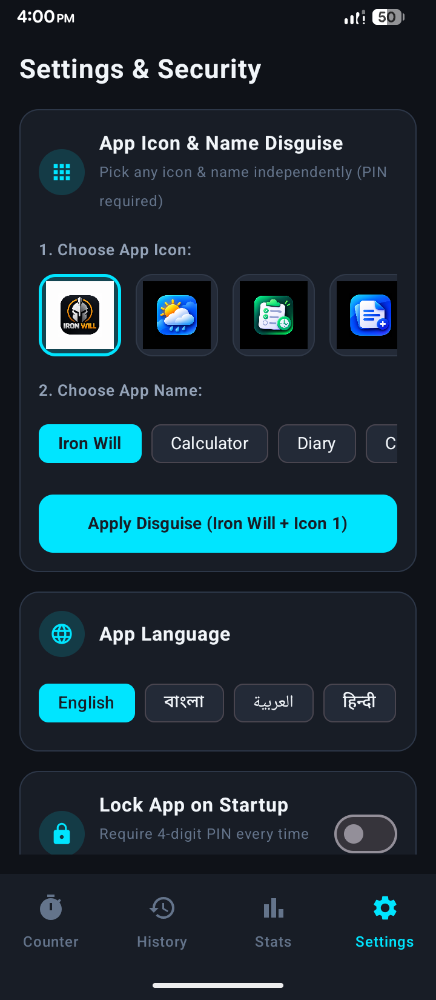

# Iron Will

**Build discipline. Track progress. Stay focused.**

<p>
  <a href="https://github.com/mahadihasan9/IronWill/releases/latest">
    
  </a>
  
  
</p>

Iron Will is a privacy-focused Android streak and habit tracker. It records clean-time progress in real time, celebrates milestones, supports multiple timers, and helps you stay consistent through motivational reminders and rank-based progress.

## Download

[Download the latest APK](https://github.com/mahadihasan9/IronWill/releases/latest) from GitHub Releases.

**Current release:** `v3.5`

## What's New in v3.5

- **Automatic encrypted backups** - Schedule local database backups to a folder you choose.
- **Rank progression** - Track progress through Novice, Iron Will, Steel Mind, Titan, Iron Legend, and more.
- **Motivational reminders** - Receive progress reminders while streak tracking is active.
- **Built-in update checker** - Check for a newer release directly from Settings.
- **Improved timer saving** - Preserves streak data more reliably.
- **Better backup controls** - Improved backup settings and encrypted restore support.

## Features

- **Live streak counter** - Track days, hours, minutes, and seconds in real time.
- **Multiple streak timers** - Run and manage separate timers for different habits or goals.
- **Goal progress** - Set a target and follow your progress toward it.
- **Ranks and achievements** - Unlock Bronze, Silver, Gold, Platinum, Diamond, and Titanium milestones.
- **Detailed history** - Record relapses, dates, streak lengths, and personal notes.
- **Statistics** - Review current streak, longest streak, lifetime activity, and timer progress.
- **Daily motivation** - Read multilingual quotes and prophetic wisdom.
- **Smart reminders** - Get motivational notifications based on the next rank progress.
- **App protection** - Use an optional 4-digit PIN for app access and sensitive actions.
- **App disguise** - Choose from 9 launcher icons and 9 neutral app names.
- **Secure backups** - Export, import, and automatically back up encrypted data.
- **Nine languages** - English, Bengali, Arabic, Hindi, Urdu, Spanish, Russian, Chinese, and Japanese.
- **Local-first privacy** - Your streak data stays on your device with no account required.

## Screenshots

<p align="center">
  
  
  
  
</p>

## Built With

- Kotlin 2.2
- Jetpack Compose + Material 3
- MVVM architecture with StateFlow
- Kotlin Coroutines
- Jetpack DataStore Preferences
- SQLite
- Android WorkManager
- Gradle Kotlin DSL

## Build from Source

### Requirements

- Android Studio with Android SDK 37
- JDK 11 or newer
- An Android device or emulator running Android 7.0 (API 24) or newer

Clone the repository and open the project in Android Studio.

Build a debug APK:

```bash
./gradlew assembleDebug
```

The APK will be created in `app/build/outputs/apk/debug/`.

Build a release APK:

```bash
./gradlew assembleRelease
```

The release APK will be created in `app/build/outputs/apk/release/`.

## Privacy

Iron Will does not require an account or send your streak data to a server. Streak history, settings, and backups are stored locally on the device. Exported backups are encrypted, and automatic backups are written only to the folder you select.

## License

Iron Will is open-source software licensed under the **GNU General Public License v2.0 (GPL-2.0)**. See [LICENSE](LICENSE) for the complete license text.

## Author

**Mahadi Hasan**
[GitHub](https://github.com/mahadihasan9)
